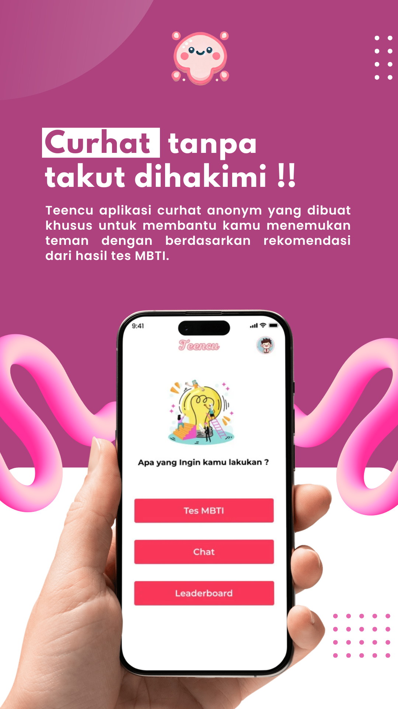

  

# Teencu

**Curhat tanpa takut dihakimi.**

Teencu adalah aplikasi untuk remaja yang dirancang sebagai ruang untuk mengenal diri, menemukan teman, dan berbagi cerita. Dengan konsep curhat anonim dan rekomendasi teman berdasarkan hasil tes MBTI, Teencu ingin membantu pengguna menemukan teman bercerita yang membuat mereka merasa nyaman.

Tidak semua cerita mudah disampaikan kepada orang di sekitar kita. Ada kalanya kita hanya membutuhkan seseorang yang bersedia mendengarkan. Teencu berangkat dari kebutuhan tersebut: menghadirkan ruang percakapan yang mengutamakan empati, keterbukaan, dan sikap saling menghargai.

## Pengalaman yang ingin dihadirkan

- **Mengenal diri sendiri** - Mengeksplorasi kecenderungan kepribadian melalui tes MBTI dan penjelasan hasilnya.
- **Menemukan teman bercerita** - Menggunakan hasil MBTI sebagai salah satu bahan rekomendasi untuk memulai pertemanan dan percakapan.
- **Berbagi cerita dengan identitas samaran** - Menghadirkan pengalaman curhat tanpa harus menampilkan identitas asli kepada pengguna lain.
- **Melihat kembali hasil tes** - Menyimpan riwayat hasil dan jawaban sebagai bahan refleksi pribadi.

## Untuk siapa Teencu?

Teencu ditujukan bagi remaja yang ingin memahami dirinya, memperluas pertemanan, atau mencari teman untuk berbagi cerita. Cerita sehari-hari, keresahan, maupun pengalaman menyenangkan dapat menjadi awal percakapan dan kesempatan untuk saling mengenal.

Hasil MBTI menjadi pembuka untuk memahami perbedaan kepribadian. Pertemanan tetap tumbuh melalui percakapan, pengalaman bersama, dan rasa saling menghargai.

## Poster Teencu

  

> Teencu masih dalam tahap pengembangan. Penjelasan dan poster ini menggambarkan konsep serta pengalaman yang ingin dihadirkan; sebagian fitur belum tersedia.
